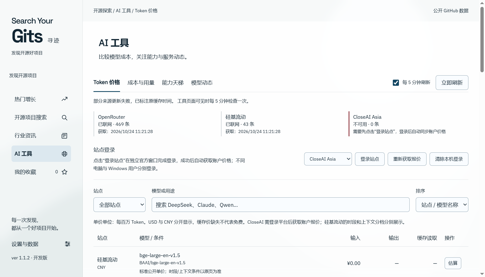

# Search Your Gits · 寻迹

一个中文 Windows 桌面应用，用于发现 GitHub 开源项目、阅读国内外技术资讯、比较 AI 模型价格与成本。

当前版本 **1.1.4** · Windows x64 · MIT。

[下载 Windows EXE 安装包](https://github.com/Johnyu21/search-your-gits/releases/download/v1.1.4/Search-Your-Gits-Setup-1.1.4-x64.exe) · [最新发布](https://github.com/Johnyu21/search-your-gits/releases/latest) · [全部 Releases](https://github.com/Johnyu21/search-your-gits/releases) · [问题与建议](https://github.com/Johnyu21/search-your-gits/issues)

仓库右侧 Releases 的 **Latest** 为最新正式版。普通用户下载 EXE 安装包即可，源码 ZIP 供开发者使用。

## 下载与安装（普通用户）

1. 在本仓库页面右侧打开 **Releases**，选择需要的版本。
2. 在 **Assets** 下载 **Search-Your-Gits-Setup-1.1.4-x64.exe**。以后版本的文件名中版本号会相应变化。
3. 双击安装器，按中文向导选择安装目录。安装到当前 Windows 用户，可创建桌面和开始菜单快捷方式。
4. 安装结束后启动 **Search Your Gits · 寻迹**。启动图默认显示约 3 秒后进入主界面。1.1.4 可在“设置与数据 → 常规与外观”关闭启动画面并保存，下次启动直接进入主界面。

**无需安装 Node.js、Python、Git 或其他开发环境。** 安装器包含运行环境，安装时无需另外下载组件；榜单、翻译、资讯及在线价格需要联网。

支持 Windows 10 / 11 的 64 位 x64 系统；本次不提供 Windows 7、32 位、macOS、Linux 或原生 ARM64 安装包。

注意区分：GitHub 自动提供的 **Source code (zip / tar.gz)** 是源码，不是安装程序；Search-Your-Gits-Source-1.1.4.zip 也是开发者源码。普通用户只需下载 **Setup…exe**。

此构建尚未使用代码签名证书，Windows 可能显示“未知发布者”或 SmartScreen 提示。请确认下载自维护者的 Release，按下文核对哈希；组织策略阻止运行时请联系管理员，不要关闭系统安全设置。

## 可以做什么

| 功能 | 使用方式与范围 |
| --- | --- |
| 热门增长 | GitHub Trending 周榜、月榜候选默认按 Star 总数倒序，可切换周期增长或来源顺序；新项目榜按创建时间筛选并按 Star 排序；季度增长使用本机历史快照，首次可能没有数据。 |
| 开源项目搜索 | 搜索公开仓库，支持语言、排序、分页及 GitHub 搜索语法；1.1.4 默认精准优先，同等匹配按 Star 倒序（当前页与最多 100 个同名补充候选内）；也可选择全局 Star 最多或最近更新。 |
| 项目详情 | 顶部固定 GitHub 打开入口、中文介绍、作者中文 README 优先、安装与用途说明、原文、收藏、历史快照和 CSV 导出。 |
| 行业资讯 | 国内 / 国外、计算机 / AI 筛选；国内 AI 使用 IT之家人工智能栏目，可翻译摘要并阅读原文。 |
| 中文阅读与更新 | 1.1.3 支持列表中文｜原文紧凑切换、翻译服务配置、限流等待与缓存，以及常驻 GitHub Release 新版本提醒。 |
| AI 工具 | OpenRouter 与硅基流动公开报价；CloseAI 官方窗口登录后同步账户报价；文本 Token 成本估算、手动用量账本、能力天梯及官方动态。 |
| 皮肤与阅读 | 启动图预设、自定义图片、明暗、透明度、模糊、玻璃阅读底色开关及页面切换动画。 |

截图来自 2026-10-24 的实际安装版验收，显示公开价格快照，不代表当前报价。价格、榜单和评测均以来源当前数据为准。

## 首次使用与数据

- 可以不填 GitHub Token。遇到 API 限流后，在“设置与数据”填写自己的 Token；通过 Windows 安全存储加密，只向 GitHub API 发送。
- CloseAI 在“AI 工具 → Token 价格 → 登录站点”中自行登录官方页面。登录状态保存在本站点的独立本机会话，应用只缓存规范化报价；可点击“清除本机登录”。
- 收藏、设置、快照与账本保存在当前 Windows 用户的应用数据目录。在“设置与数据”可打开数据目录。升级沿用原应用 ID；卸载默认保留个人数据，不会删除自定义收藏。
- 用量账本由用户手动记录，不读取供应商账单、余额或个人额度。模型公告不保证个人账户额度已刷新。Token 价格表可点击输入/输出表头按价格升序或降序排列；不同币种分开排序，未公布价格保持在最后。
- 翻译服务会接收所选公开文本；GitHub Token 不发送给翻译、资讯或价格来源。默认 MyMemory 免费服务仍有公共额度限制；可在设置中配置 LibreTranslate 或兼容 OpenAI 的完整接口地址、模型及密钥。自定义服务可能计费，程序不内置共享付费密钥。翻译仅在用户选择中文阅读/翻译时调用。
- 1.1.3 限流时优先保留缓存，显示等待时间并可取消自动重试。首次使用且没有缓存时仍需要可访问对应来源的网络；Token 无法绕过网络封锁或翻译额度。
- 1.1.3 启动后默认检查公开 Release，每 6 小时检查一次，可关闭自动检查或预览版提醒。推送源码不会触发客户端提醒，需公开发布含安装包的 Release；已安装的 1.1.2 没有更新检测功能，首次需手动升级至 1.1.3 或更高版本。

### 建议与意见

1.1.3 默认提供 **“前往 GitHub 提交”**，打开预填的 Issue 页面，需要用户登录并确认公开发布；打开网页不代表已经提交。草稿保存在本机，内容过长时复制到剪贴板并提示粘贴。1.1.2 的自动邮件按钮依赖服务配置。

自动发邮件仍需要维护者部署独立 HTTPS 反馈服务。配置服务后可自动发送，成功提交后需等待 15 分钟再次提交；客户端和仓库不包含 SMTP 凭据。

SMTP 密码和授权码只放在服务端，绝不包含在 EXE、源码 ZIP 或仓库中。部署方法见 [反馈服务说明](server/README.md)。公开问题可以通过本仓库 **Issues** 提交；请勿粘贴密码、Token 或私人数据。

## 校验下载文件

Release 同时提供 SHA256SUMS.txt。在安装包所在目录打开 PowerShell：

~~~powershell
Get-FileHash .\Search-Your-Gits-Setup-1.1.4-x64.exe -Algorithm SHA256
~~~

将结果与 SHA256SUMS.txt 中同名文件的哈希逐字对照。哈希用于核对文件完整性，不能替代对发布者和下载来源的确认。

## 开发与本地构建（开发者）

开发要求：Windows x64、Node.js 22.16+ 与 npm。获取源码后：

~~~powershell
npm ci
npm test
npm start
~~~

可选桌面联调：在 Windows 运行 `npm run test:desktop`，使用临时用户目录与模拟响应，不提交真实 Issue 或发送邮件；截图输出到被 Git 忽略的 `.qa-desktop/`。`node scripts/check-startup.cjs` 另行使用临时用户目录验证启动画面开启与关闭。

本地也可以双击“启动开发版.cmd”；它是开发入口，普通安装包用户不需要使用。首次 npm ci 会下载 Electron；需要能访问 npm 和 Electron 下载源。

构建安装包：

~~~powershell
npm run dist
npm run release:check
~~~

构建先运行测试，再生成中文 NSIS 安装器、白名单源码 ZIP 和 SHA256 校验文件，输出到 release/1.1.4/。打包不自动发布 GitHub，也不自动递增版本。

| 目录 | 内容 |
| --- | --- |
| ui/ | 中文界面、皮肤、字体和启动图 |
| lib/ | 榜单、翻译、资讯、价格、账本、反馈协议 |
| server/ | 独立反馈服务，仅供服务端部署 |
| scripts/ | 开发启动、构建与产物校验 |
| test/ | 无需真实邮件或付费模型调用的自动测试 |
| docs/ | 数据口径、发布指南、验证记录和脱敏需求档案 |
| .github/ | CI、手动打包及标签触发的草稿 Release 流程 |
| release/ | 本机生成产物，不提交 Git |

## 维护与许可证

[发布到 GitHub 的步骤](docs/RELEASING.md) · [安装验收记录](docs/VALIDATION.md) · [数据来源与计价口径](docs/DATA-SOURCES.md) · [版本历史](CHANGELOG.md) · [第三方许可](THIRD-PARTY-NOTICES.md) · [需求档案](docs/用户需求与提示词记录.md)

原创代码采用 [MIT License](LICENSE)，允许复用和商业使用，需保留版权和许可声明；第三方组件、字体与商标按各自许可使用。
